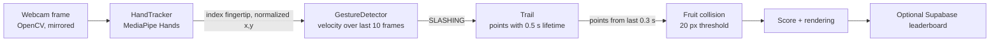

# MiniNinja

A webcam fruit-slicing game controlled by your index finger. MediaPipe Hands tracks the hand, a velocity check turns fast fingertip motion into a slash, and OpenCV renders the game. No controllers or touchscreen, just a camera. A small Python prototype; inspired by Fruit Ninja.

<!-- TODO: demo GIF of gameplay (hand swipe slicing fruit, trail visible) -->

## Highlights

- Single-hand tracking with MediaPipe Hands (21 landmarks); the game uses the index fingertip (landmark 8).
- Omnidirectional slashing: any fast fingertip motion counts, not only fixed swipe directions.
- Fading slash trail; collisions are tested against recent trail points, not only the current fingertip position.
- Three difficulty presets (spawn rate, fruit speed, slash sensitivity), resolution and debug options via CLI.
- Optional online leaderboard backed by Supabase (the game runs without it).

## How it works



- `src/cv/hand_tracker.py` wraps `mp.solutions.hands` (1 hand, detection/tracking confidence 0.7) and returns the first hand's landmarks as normalized `(x, y)`.
- `src/cv/gesture_detector.py` keeps the last 10 index-fingertip positions and computes the average per-frame displacement across that window. If the speed (normalized units per frame) exceeds `MIN_SLASH_VELOCITY`, the state is `SLASHING`. When the hand is lost, the history is cleared.
- `src/core/entities.py` defines `Fruit` and `Trail`; `src/core/game.py` runs the loop (spawning, upward movement, collisions, scoring, drawing). Fruits are sliced when a trail point from the last 0.3 s is within the slice threshold.
- `src/core/config.py` holds all tunables and the difficulty presets.
- `src/leaderboard/` and `src/ui/` implement the optional Supabase score submission and its display.

## Tech stack

Python 3.11+, OpenCV, MediaPipe (`>=0.10.14`), supabase-py, python-dotenv; dependencies managed with `uv`.

## Getting started

Prerequisites: Python 3.11+, a webcam (camera index 0 is hard-coded in `src/core/game.py`), and [uv](https://docs.astral.sh/uv/) (or pip).

```bash
git clone https://github.com/bigalex95/minininja.git
cd minininja/proto
uv sync                 # or: pip install -e .
uv run python main.py --help
uv run python main.py                              # medium difficulty, 640x480
uv run python main.py --difficulty hard --debug    # show landmarks and slash status
uv run python main.py --width 1280 --height 720
```

Options: `--difficulty {easy,medium,hard}`, `--width`, `--height`, `--debug`, `--no-trail`, `--player-name`, `--show-leaderboard`.

### Leaderboard (optional)

At game end the score is submitted to Supabase if credentials are available; otherwise a warning is printed and the game still works.

```bash
cp .env.example .env     # set SUPABASE_URL and SUPABASE_KEY
```

Create the table with [`proto/docs/supabase_schema.sql`](proto/docs/supabase_schema.sql); step-by-step instructions are in [`proto/docs/SUPABASE_SETUP.md`](proto/docs/SUPABASE_SETUP.md). Helper scripts are in `proto/scripts/`.

## Controls

| Input | Action |
| --- | --- |
| Move index finger fast | Slash (any direction) |
| `q` | Quit |

Keep one hand in view with good lighting. If slashes are missed, move faster or lower `MIN_SLASH_VELOCITY` (the `hard` preset has the lowest threshold, so it is the most sensitive to motion); the tunables are `MIN_SLASH_VELOCITY`, `DETECTION_CONFIDENCE` and `TRACKING_CONFIDENCE` in `proto/src/core/config.py`.

| Preset | Spawn interval | Fruit speed | Min slash velocity |
| --- | --- | --- | --- |
| easy | 2.0 s | 3 px/frame | 0.05 |
| medium | 1.5 s | 5 px/frame | 0.03 |
| hard | 1.0 s | 7 px/frame | 0.02 |

## Project structure

```
minininja/
  proto/
    main.py              # CLI entry point
    pyproject.toml, uv.lock
    .env.example         # Supabase credentials template
    src/
      core/              # config.py, entities.py, game.py
      cv/                # hand_tracker.py, gesture_detector.py
      leaderboard/       # Supabase client
      ui/                # leaderboard rendering
    scripts/             # Supabase setup helpers
    docs/                # SUPABASE_SETUP.md, supabase_schema.sql
    tests/test_structure.py   # import and file-layout check
  LICENSE
```

## Status and roadmap

Working Python prototype; only the `proto/` implementation exists. No latency or FPS benchmarks have been recorded, and the tests only check imports and file layout (`cd proto && uv run python tests/test_structure.py`).

Ideas, not implemented: gesture unit tests with recorded landmark sequences, a benchmark script, bombs and combos, sound, multi-hand support, flattening `proto/` into the repo root, a native C++/Qt port.

## License

MIT, see [LICENSE](LICENSE).
